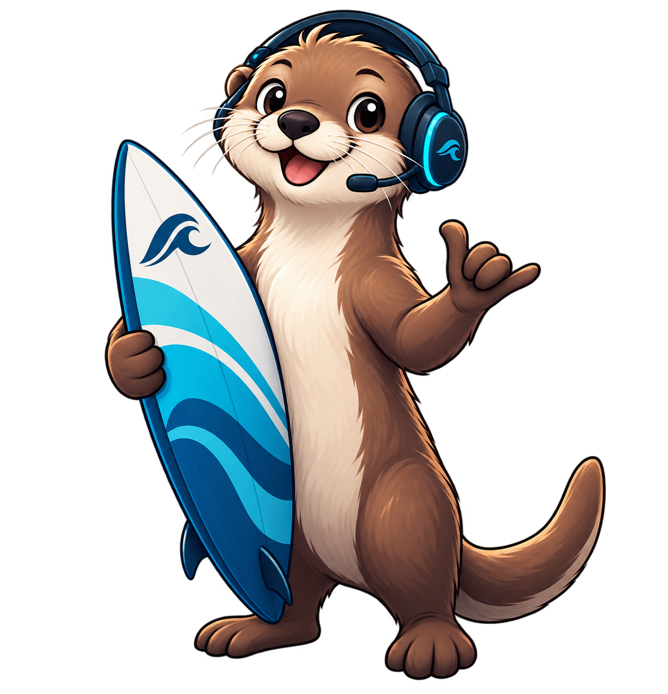

# 🌊 LANsurfer

**Find your crew. Catch the next game.**

**LANsurfer is back.**

Originally built for LAN parties in the early 2000s.<br>
Reimagined as an open-source **Looking for Group (LFG)** platform for gaming communities.

Self-hosted and built for LAN parties, gaming events, and the people who bring them to life.

Hundreds of players. Dozens of games. And somewhere in the room, someone else is thinking: *“Anyone up for Warcraft III?”*

**You just need to find each other.**

[The idea](#-what-is-lansurfer) · [How it works](#-how-it-works) · [Project status](#-project-status) · [Get involved](#-get-involved)

> 🚧 **Early development:** the backend foundation is in place. The player-facing experience described below is planned for the first prototype; there is no playable web UI yet.

## 🎮 What is LANsurfer?

Maybe it's a quick round of Counter-Strike. Maybe it's FlatOut 2, an all-night OpenTTD session, or that obscure game you haven't launched in twenty years.

Chances are, someone brought it too.

LANsurfer aims to give everyone at the event a shared place to find out what others want to play, follow their favorite games, and get a group together. From Warcraft III and Age of Empires II to Trackmania, Quake III Arena, and Unreal Tournament — old favorites deserve another round.

The original use case is **CXT**, a LAN party with around **400 participants**. The goal is to make those spontaneous “let's play something” moments easier for LAN organizers and gaming communities everywhere.

## 🏄 How it works

The first prototype will focus on a simple browser-based flow:

1. **Follow your games.** Pick the games you'd like to play and find them again in My Games.
2. **Find players.** Create a Game Request with a start time, an optional player limit, and a short description.
3. **Join a game.** Browse requests, see who's still looking for players, and join in. Live updates keep player counts and new requests visible in the browser.

A request could look like this — an illustration of the planned experience:

```text
Warcraft III
2 / 4 players · Starts now

“Casual 2v2 — getting back into WC3.
 Rusty players welcome 😄”

[ Join ]
```

Once the group is ready, it's time to launch the game.

**Follow games → Find players → Play together**

## 🌊 Built for your community

- **Your LAN, your instance.** Organizers can host LANsurfer on their own infrastructure and maintain the games available at their event.
- **A place for the classics.** The local game catalog can include the games your community actually plays, including the less obvious ones.
- **Easy to join in.** The first release targets desktop and mobile browsers, with quick, readable game requests.
- **Built in the open.** Players, organizers, designers, and developers can help shape the project.

## 🦦 Meet the LANsurfer Otter



An otter with a headset and a surfboard feels right at home here: social, at ease in the water, and ready for the next game.

The otter brings a little personality to LANsurfer's ocean-inspired identity. In the application, the wording stays familiar: games, players, events, and joining a game.

The [visual branding guide](docs/BRANDING.md) defines the palette, typography, mascot usage, and dark/light interface direction for the first prototype.

## 🗺️ Project status

We're building toward a **web-only v0.1 prototype** to try at a real LAN event. The backend and database foundation are implemented; the web interface is the next milestone. Login, following games, and creating or joining requests are still ahead.

The [roadmap](docs/ROADMAP.md#progress) tracks completed work and what's next. The [product definition](docs/PRODUCT.md#5-v01-scope) describes the first release in detail.

Discord, Web Push, external game catalogs, and a separate Ready-to-Play status are possibilities for later. They are outside the first prototype. The design and database may still change during development.

## 🐳 Try the development foundation

With this repository checked out and Docker with Docker Compose installed, start LANsurfer and PostgreSQL:

```sh
docker compose up --build
```

This currently starts the backend, including automatic database migrations. Check that it is running:

```sh
curl http://localhost:8080/healthz
curl http://localhost:8080/readyz
```

Expect `ok` from `/healthz` and `ready` from `/readyz`. There is no homepage yet. Stop the stack with:

```sh
docker compose down
```

The Compose credentials are development defaults; do not use them for an exposed deployment. See the [contributing guide](CONTRIBUTING.md#development-setup) for local Go development, configuration, and checks.

## 🤝 Get involved

Have you organized a LAN? Spent half the evening trying to find a fourth player? We'd love your perspective.

You can help with interface design, development, documentation, bug reports, and testing at LAN events. Share a concrete use case in an [issue](https://github.com/convention-x-treme/lansurfer/issues), or start with the [contributing guide](CONTRIBUTING.md).

For the technical side, LANsurfer is a modular Go monolith with server-rendered pages and PostgreSQL. The [architecture](docs/ARCHITECTURE.md) explains the choices; [development rules](AGENTS.md) cover repository conventions and commands.

## 📜 License

LANsurfer is free and open-source software under the [GNU Affero General Public License v3.0 (AGPL-3.0)](LICENSE).

---

Sometimes the best game at a LAN is the twenty-year-old one you suddenly discover ten other people also want to play.

**Built for LAN parties. Built for gaming communities. Built in the open.**
